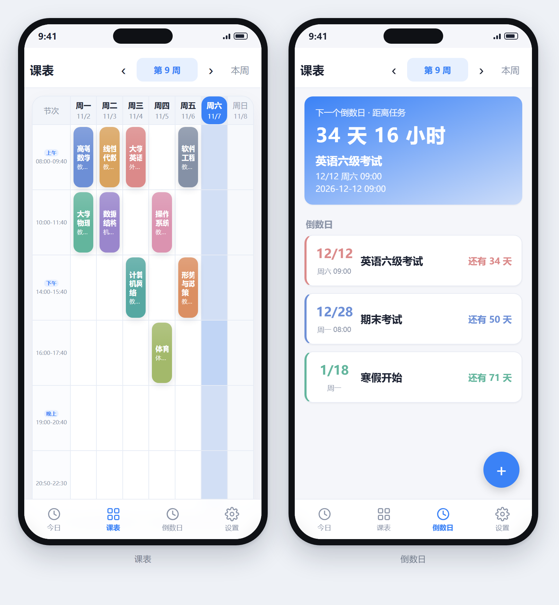

<p align="center">
  
</p>

# 极简课表

一个本地运行的课程表应用，提供网页版（PWA）和安卓安装包两种形态，两者共用同一套代码。

界面分为四页：今日、课表、倒数日、设置，通过底部标签切换。

## 下载

安卓安装包最新版为 v1.32：

```
https://github.com/watermeloncat472/minimal-timetable/raw/master/%E8%AF%BE%E8%A1%A8/%E6%9E%81%E7%AE%80%E8%AF%BE%E8%A1%A8-v1.32.apk
```

也可以在仓库的 [Releases](https://github.com/watermeloncat472/minimal-timetable/releases) 页面下载（若已发布对应版本）。

安装说明：

- 将 APK 传到手机后点击安装。系统提示「未知来源」时，需要在设置中允许当前应用安装应用。
- 当前使用 debug 签名，适合个人安装，未针对应用商店做 release 签名配置。
- 升级时直接覆盖安装，不要先卸载。课表数据保存在应用本地存储中，卸载会一并清除。

网页版无需安装：

- 直接打开 `课表/minimal-timetable/index.html`；
- 或部署到任意静态托管服务后访问；
- 通过 http/https 打开后，可在浏览器菜单中选择「添加到主屏幕」，以独立窗口运行，离线可用。

## 功能

**课表**

- 周一至周日七列网格，表头与左侧节次时间固定，只有课程区域上下滚动。
- 当天所在列高亮，当前节次有额外标记。
- 支持单节、双节及更长连堂；同一格出现多门课时并排显示。
- 可设置每门课的上课周次。

**今日**

- 列出当天课程与时间、地点。
- 显示下一节课的倒计时：未到上课时间显示距上课，上课中显示距下课。

**倒数日**

- 记录事件名称、日期、时间与备注。
- 按日期排序，长按可拖动调整顺序。
- 剩余天数低于设定阈值时标红提醒。

**导入**

- 支持 `.xlsx`、`.csv`、`.xls`，可识别网格表（星期 × 节次）和列表表（一行一课）。
- 导入前逐条预览，可修改、删除，并检测同格冲突。
- 文件无法在手机中找到时，可以复制表格内容后用「粘贴表格」导入。

**外观与设置**

- 6 套主题色，可自定义主色调，支持浅色与深色模式。
- 时间显示支持「大学双节合并」和「中学每节单列」两种模式。
- 可编辑每节课的起止时间，支持新增或删除节次。
- 上课提醒：可设提前分钟数，通过浏览器通知提醒，仅在应用运行期间生效。

**数据**

- 所有数据保存在浏览器 `localStorage`，不上传服务器。
- 支持导出 JSON 备份。更换设备或清除浏览器数据前请先导出。

## 技术栈

| 项目 | 说明 |
|---|---|
| 界面 | 原生 HTML / CSS / JavaScript，无框架、无构建步骤 |
| 存储 | `localStorage`，配合 JSON 导出与导入 |
| 离线 | Web App Manifest + Service Worker |
| 安卓封装 | Capacitor 7，包名 `com.minimal.timetable` |
| 最低系统 | Android 6.0（API 23） |

## 项目结构

```
课表/
├── minimal-timetable/          网页端源码（PWA）
│   ├── index.html              页面结构
│   ├── style.css               样式与主题变量
│   ├── app.js                  数据、渲染、倒计时、提醒、备份
│   ├── excel-import.js         表格导入
│   ├── manifest.webmanifest    PWA 清单
│   ├── sw.js                   Service Worker
│   ├── icons/                  应用图标
│   └── README.md               产品设计文档
├── android-build/              Capacitor 安卓工程
│   ├── capacitor.config.json
│   └── android/                Gradle 工程
└── 极简课表-v1.32.apk          安装包
```

交互细节、数据模型和版本记录见 [`课表/minimal-timetable/README.md`](课表/minimal-timetable/README.md)。

## 本地运行

直接打开网页文件，或启动一个静态服务器：

```bash
cd 课表/minimal-timetable
python -m http.server 8000
# 浏览器访问 http://localhost:8000
```

通过 `file://` 直接打开时功能正常，但 Service Worker 不会注册，因此没有离线缓存。

## 构建安卓安装包

环境要求：JDK 21、Android SDK（platform 35、build-tools 35.0.0）。Capacitor 7 要求 Java 21，使用 JDK 17 会编译失败。

```bat
cd 课表\android-build
npx cap sync android

cd android
set JAVA_HOME=<JDK 21 路径>
set ANDROID_HOME=<Android SDK 路径>
gradlew.bat assembleDebug
```

产物位于 `android-build/android/app/build/outputs/apk/debug/app-debug.apk`，重命名后放入 `课表/` 目录。

修改网页代码后需要重新执行 `npx cap sync android`，否则安卓工程内仍是旧资源。

构建脚本会把网页资源复制到 `android/app/src/main/assets/public/`，该目录已在 `.gitignore` 中排除。

覆盖安装要求签名一致。debug 构建使用本机的 debug keystore，更换构建环境后签名可能变化，此时只能卸载重装。

## 更新记录

**v1.32**

- 修复切换到下一周时可能跳错周或连跳两周的问题。切换前先读取当前周作为基准，再切换到手动模式，并限制短时间内的重复点击。
- 修复倒数日无法选择颜色的问题。颜色变量声明方式导致的赋值异常已修正。

## 许可

本仓库未声明开源协议，保留所有权利。如需用于学习、二次开发或分发，请先与作者联系。
